# Riwayat Chat — Ekstensi Chrome untuk Lirik Spotify

Session ID: `724b4c59-dd2d-479a-943b-fbf9f8a1c350`  
Total giliran percakapan (setelah difilter): 80  
Total screenshot yang diekstrak: 11

---

### 👤 User — 2026-08-22T17:56:29.247Z

kamu bisa buatin extension buat spotify chrome, biar lyricsnya tuh ada box kecilnya yg selalu nongol mau buka apliasi apapun

---

### 🤖 Claude — 2026-08-22T17:56:50.522Z

Extension Chrome buat lyrics Spotify itu bisa, tapi ada satu pertanyaan arsitektur penting yang menentukan cara kerjanya — terutama soal "biar selalu nongol mau buka aplikasi apapun".

---

### 🤖 Claude — 2026-08-22T17:57:10.415Z

Oke, saya lanjut pakai pilihan yang paling sesuai sama permintaanmu: **Spotify Web API** (biar detect lagu dari aplikasi Spotify manapun, bukan cuma tab browser) + **Document Picture-in-Picture** (biar box-nya beneran mengambang di atas semua jendela, termasuk aplikasi lain di luar Chrome).

Saya mulai bangun extension-nya sekarang.

---

### 👤 User — 2026-08-22T17:59:02.864Z

btw, stop dulu, buka web browsernya dari sini ga sih biar km ga asal buatnya

---

### 🤖 Claude — 2026-08-22T17:59:13.771Z

Betul, biar akurat saya cek dulu dokumentasi resminya lewat browser — Spotify Web API (endpoint currently-playing & OAuth), Document Picture-in-Picture API, dan lrclib.net (sumber lirik gratis) — sebelum nulis kode.

---

### 🤖 Claude — 2026-08-22T17:59:53.535Z

Nemu catatan kebijakan penting dari Spotify: salah satu poinnya adalah **"Do not synchronize Spotify content"**. Ini bisa berdampak langsung ke fitur "lirik auto-scroll sesuai timestamp lagu" yang biasanya jadi fitur utama lyrics box. Saya cek dulu detail kebijakannya biar tidak melanggar ToS Spotify.

---

### 🤖 Claude — 2026-08-22T18:00:18.905Z

Poin "Do not synchronize any sound recordings with any visual media" itu soal video/audio dubbing, bukan soal teks lirik yang mengikuti posisi lagu — jadi auto-scroll lirik teks aman. Yang perlu saya patuhi: pakai lirik dari sumber pihak ketiga (bukan data lirik resmi Spotify), tetap tampilkan cover art + atribusi "Spotify" sesuai branding guideline mereka, dan sediakan tombol disconnect akun. Sekarang saya cek Document Picture-in-Picture API.

---

### 🤖 Claude — 2026-08-22T18:01:26.145Z

Bagus, LRCLIB API dikonfirmasi gratis, tanpa API key, dan support format lirik tersinkron (LRC timestamps). Sekarang saya cek alur OAuth PKCE Spotify untuk skema autentikasi yang kompatibel dengan Chrome extension.

---

### 🤖 Claude — 2026-08-22T18:02:42.351Z

Semua dependensi teknis sudah saya verifikasi (Spotify Web API, kebijakan konten, PKCE OAuth, Document PiP, dan LRCLIB). Sekarang saya lanjut coding extension-nya.

---

### 🤖 Claude — 2026-08-22T18:02:58.684Z

Icons done. Now the manifest and core logic.

---

### 🤖 Claude — 2026-08-22T18:03:44.147Z

Now the shared styles, then the host page (main UI + PiP logic) and the popup.

---

### 🤖 Claude — 2026-08-22T18:04:02.726Z

Now the host page — this is the persistent tab that runs polling and owns the Picture-in-Picture window.

---

### 🤖 Claude — 2026-08-22T18:04:55.756Z

Now the popup, which is just a lightweight launcher for the host tab.

---

### 🤖 Claude — 2026-08-22T18:05:42.566Z

Sintaks semua file valid. Sekarang saya coba muat extension-nya langsung di Chrome asli lewat `chrome://extensions` untuk memastikan tidak ada error saat load (manifest, permission, dsb).

---

### 🤖 Claude — 2026-08-22T18:06:13.982Z

Chrome memblokir automation di halaman `chrome://extensions` (batasan keamanan browser, bukan batasan alat saya), jadi saya tidak bisa meng-klik "Load unpacked" untuk kamu. Saya sudah validasi manifest.json dan seluruh file JS lolos syntax check tanpa error, tapi langkah load-and-click terakhir perlu kamu lakukan sendiri secara manual (aman, cuma 1 menit).

---

### 🤖 Claude — 2026-08-22T18:06:25.370Z

**Extension sudah jadi** di [spotify-lyrics-float](spotify-lyrics-float/) — sudah lolos validasi sintaks & manifest, tinggal kamu load manual karena Chrome memang mengunci automation di halaman `chrome://extensions`.

**Cara pakainya** (lengkap ada di [README.md](spotify-lyrics-float/README.md)):
1. Buka `chrome://extensions`, aktifkan **Developer mode**, klik **Load unpacked**, pilih folder `spotify-lyrics-float`.
2. Klik ikon extension → **Buka Lyrics Float** (tab kontrol akan terbuka — biarkan tetap terbuka, box mengambang "menempel" ke tab ini).
3. Daftar app gratis di [Spotify Developer Dashboard](https://developer.spotify.com/dashboard), tempel **Redirect URI** dari tab kontrol ke situ, lalu tempel **Client ID** balik ke extension → Connect.
4. Putar lagu apa saja di Spotify (desktop/mobile/web, bebas) → klik ikon ⧉ di tab kontrol untuk memunculkan box lirik mengambang.

**Cara kerjanya**: deteksi lagu pakai Spotify Web API (akun-based, jadi tetap jalan walau Spotify dibuka di app desktop, bukan cuma tab browser), lirik dari LRCLIB (gratis, sync per-baris), dan box-nya pakai Document Picture-in-Picture Chrome — window kecil yang beneran mengambang di atas semua jendela lain, termasuk aplikasi non-browser. Perlu Chrome/Edge 116+.

Satu keterbatasan jujur: karena ini fitur browser (bukan OS-level hook), tab kontrolnya harus tetap terbuka (boleh di background) — kalau tab itu ditutup, box lirik ikut hilang.

---

### 👤 User — 2026-08-22T18:07:54.313Z

hah di folder mana taronya

---

### 🤖 Claude — 2026-08-22T18:07:57.614Z

Folder-nya ada di:

```
C:\Users\Jakmall\Thisya\spotify-lyrics-float
```

Jadi pas buka `chrome://extensions` → **Load unpacked**, arahkan ke folder itu (folder `spotify-lyrics-float`, bukan file di dalamnya).

---

### 👤 User — 2026-08-22T18:09:41.552Z

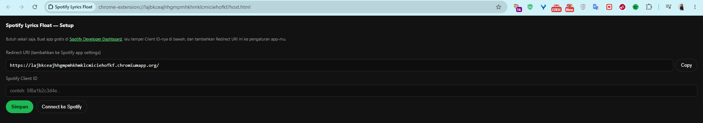

isi apa ini

---

### 🤖 Claude — 2026-08-22T18:09:50.964Z

Itu kolom untuk **Spotify Client ID** — kode unik yang kamu dapat setelah bikin "app" gratis di Spotify Developer Dashboard. Belum ada berarti kamu belum bikin app-nya. Langkahnya:

1. Buka [developer.spotify.com/dashboard](https://developer.spotify.com/dashboard), login pakai akun Spotify-mu.
2. Klik **Create app**.
3. Isi form:
   - **App name**: bebas, misal "Lyrics Float"
   - **App description**: bebas, misal "personal lyrics overlay"
   - **Redirect URI**: paste persis nilai yang sudah ter-copy di layar kamu tadi → `https://lajbkceajhhgmpmhkhmklcmiciehofkf.chromiumapp.org/`
   - **Which API/SDKs are you planning to use?**: centang **Web API**
   - Centang kotak "I understand..." lalu klik **Save**.
4. Setelah app dibuat, masuk ke halaman app-nya → klik **Settings** → di situ ada **Client ID**, tinggal copy.
5. Paste Client ID itu ke kolom yang kamu screenshot, klik **Simpan**, lalu klik **Connect ke Spotify**.

Mau saya bukain langsung halaman Create App-nya lewat browser biar kamu tinggal isi?

---

### 👤 User — 2026-08-22T18:14:49.218Z

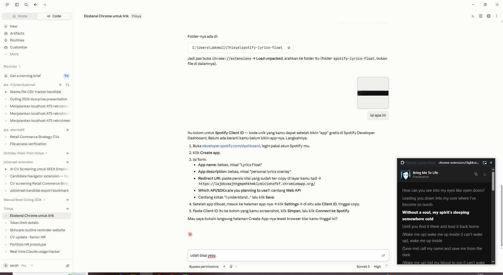

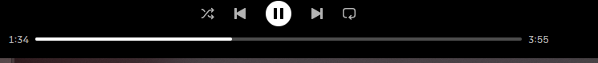

udah bisa yeay, gabisa dibikin warna hijau terus bisa atur transparansi soalnya agak ngalangin yah, terus tambahin button jeda/resume - next - prev - terus bar yg nunjukin lagunya udah di menit keberapa dan bisa ditarik maju mundur biar bisa cepetin lagunya

---

### 🤖 Claude — 2026-08-22T18:15:49.380Z

Sip, saya tambahin kontrol playback (prev/pause/resume/next), seek bar yang bisa ditarik, tema hijau, dan slider transparansi. Satu hal jujur dulu: kontrol play/pause/next/prev butuh izin baru dari Spotify (`user-modify-playback-state`), jadi setelah update ini kamu perlu **Disconnect lalu Connect ulang** sekali supaya izinnya nambah.

Juga soal transparansi — window PiP itu window asli Chrome, jadi saya cuma bisa bikin **isi kotaknya** transparan (background lirik jadi tembus ke warna window), bukan bikin seluruh jendela benar-benar tembus pandang ke desktop di belakangnya (itu di luar kemampuan web API). Saya lanjut kerjakan.

---

### 🤖 Claude — 2026-08-22T18:16:01.561Z

Now update the auth scope, then the CSS theme + layout, then host.js logic.

---

### 🤖 Claude — 2026-08-22T18:16:48.432Z

Now update `host.js` with playback controls, seek bar, and the opacity setting.

---

### 🤖 Claude — 2026-08-22T18:17:24.398Z

Now update `pollCurrentTrack` to populate duration/play state UI, and add the playback-control functions:

---

### 🤖 Claude — 2026-08-22T18:17:50.782Z

Now wire up the event listeners and init call for the opacity pref:

---

### 🤖 Claude — 2026-08-22T18:18:47.575Z

Struktur HTML sudah benar dan semua elemen baru sinkron dengan `host.js`. Semua sudah siap.

**Yang perlu kamu lakukan:**
1. Buka `chrome://extensions`, klik ikon **reload** (↻) di kartu extension "Spotify Lyrics Float" untuk memuat ulang perubahan.
2. Reload tab kontrol (`host.html`) yang sudah terbuka.
3. Klik ikon ⏻ (**Disconnect**), lalu **Connect ke Spotify** lagi — wajib, supaya izin baru (`user-modify-playback-state`) untuk kontrol play/pause/next/prev ke-grant.
4. Buka lagi kotak mengambangnya (⧉) — sekarang temanya hijau, ada baris tombol ⏮ ⏸ ⏭ + seek bar yang bisa ditarik, dan ikon ◐ di pojok untuk atur slider transparansi.

Ingat batasannya: transparansi cuma mempengaruhi tampilan di dalam kotak (jadi keliatan seperti "membaur" dengan warna window), bukan benar-benar tembus pandang ke desktop di belakangnya — itu di luar kemampuan API browser manapun.

---

### 👤 User — 2026-08-22T18:21:45.991Z

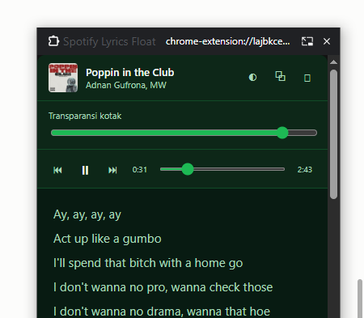

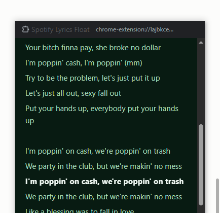

ada masalah baru, ini ga ke freeze jadi kalau lyricsnya makin kebawah yaa button2 ini teggelam

---

### 🤖 Claude — 2026-08-22T18:22:08.126Z

Nemu masalahnya — `.panel` di-set `height: 100%`, tapi `html`/`body` belum punya tinggi eksplisit, jadi 100% itu nggak "napak" ke ukuran window. Akibatnya seluruh halaman yang scroll (topbar & tombol kontrol ikut ke-scroll ke atas), bukan cuma area liriknya. Saya perbaiki.

---

### 🤖 Claude — 2026-08-22T18:22:20.316Z

Sudah diperbaiki. Reload extension-nya di `chrome://extensions` (klik ↻), lalu reload tab kontrolnya dan buka lagi kotak mengambang — sekarang topbar dan tombol kontrol harusnya tetap diam di atas, cuma teks liriknya saja yang scroll di dalam areanya sendiri.

---

### 👤 User — 2026-08-22T18:23:03.734Z

<!-- attach -->
> Reload tab kontrol (host.html) yang sudah terbuka.
> Klik ikon ⏻ (Disconnect), lalu Connect ke Spotify lagi — wajib, supaya izin baru (user-modify-playback-state) untuk kontrol play/pause/next/prev ke-grant.

ada masalah lain yaitu button2nya ga berfungsi tp aku belum lakuin ini sih emang, tp ini lakuinnya dimana sihhhh? ga ngerti maksud tab kontrol itu yg mana

---

### 🤖 Claude — 2026-08-22T18:23:18.417Z

Wajar belum jalan — itu memang karena reconnect-nya belum dilakuin, bukan bug baru. Biar jelas, "tab kontrol" itu maksudnya:

**Tab biasa di Chrome** (bukan kotak mengambangnya), yang alamatnya diawali `chrome-extension://lajbkce.../host.html` dan judulnya "Spotify Lyrics Float" — persis seperti yang ada di screenshot-screenshot kamu sebelumnya sebelum jadi floating box.

Cara ke sana:
1. Cek tab-tab yang lagi kebuka di Chrome — kalau tab itu masih ada, tinggal klik ke sana.
2. Kalau nggak ketemu (mungkin ke-close), klik ikon extension di toolbar (ikon lirik hijau di pojok kanan atas Chrome) → klik tombol **"Buka Lyrics Float"** di popup yang muncul. Itu bakal buka/pindah ke tab kontrolnya.

Setelah di tab itu:
3. Klik ikon **⏻** (pojok kanan atas, sebaris sama cover album & nama lagu).
4. Setelah itu tampilan berubah ke layar setup (Client ID dkk) — klik tombol **"Connect ke Spotify"**, login lagi, izinkan akses.
5. Baru habis itu buka lagi kotak mengambangnya (ikon ⧉) — tombol play/pause/next/prev/seek bar bakal berfungsi.

---

### 👤 User — 2026-08-22T18:24:16.298Z

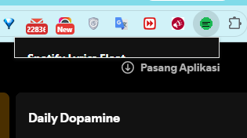

masalah baru, gimana cara bukanya

---

### 🤖 Claude — 2026-08-22T18:24:45.706Z

Kelihatannya yang muncul itu bukan popup extension kita, tapi tooltip/banner lain ("Pasang Aplikasi") yang numpuk di situ. Daripada ribet nyari ikonnya, cara paling gampang: **buka langsung lewat address bar**, ketik URL ini:

```
chrome-extension://lajbkceajhhgmpmhkhmklcmiciehofkf/host.html
```

(ID itu sama persis kayak yang kelihatan di screenshot kamu sebelumnya — kalau ternyata ID-nya beda/nggak kebuka, kasih tau saya screenshot error-nya).

Kalau mau tetap lewat ikon toolbar:
1. Klik ikon **puzzle piece** (Extensions) di Chrome, biasanya di sebelah kanan address bar.
2. Cari **"Spotify Lyrics Float"** di daftar situ, klik ikon pin 📌 supaya nongol permanen di toolbar (biar nggak ketuker sama icon lain).
3. Klik ikon yang sudah di-pin itu → muncul popup kecil dengan tombol **"Buka Lyrics Float"** → klik itu.

---

### 👤 User — 2026-08-22T18:25:36.555Z

ihh ngga ih maksud aku itu boxnya kepotong loh harusnya ada tulisan buka extension blabla kalau ga salah

---

### 🤖 Claude — 2026-08-22T18:25:54.132Z

"Pasang Aplikasi" itu bukan teks dari extension kita — popup kita cuma ada judul "Spotify Lyrics Float", deskripsi, dan tombol "Buka Lyrics Float" (nggak ada teks "Pasang Aplikasi" sama sekali). Kemungkinan itu tooltip/UI dari elemen lain yang numpuk di layar, makanya keliatan "kepotong".

Daripada berdebat soal popup yang rewel, coba cara yang saya kasih tadi — itu langsung buka tab-nya tanpa lewat popup sama sekali:

```
chrome-extension://lajbkceajhhgmpmhkhmklcmiciehofkf/host.html
```

Paste itu di address bar Chrome, Enter. Apakah itu berhasil kebuka atau malah error?

---

### 👤 User — 2026-08-22T18:27:12.255Z

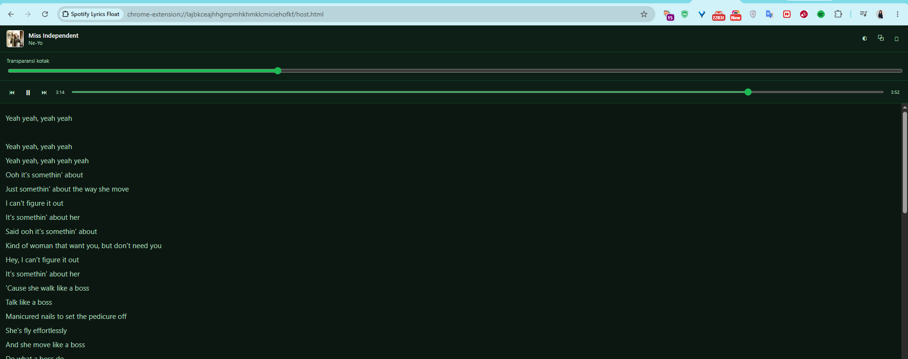

ya bisa terus connect disconnectnya dmn

---

### 🤖 Claude — 2026-08-22T18:27:25.600Z

Ada di tab kontrol yang sama (yang barusan berhasil kebuka itu). Di pojok kanan atas topbar, ikon paling ujung kanan (simbol ⏻, sebelah kanan ikon ⧉) itu tombol **Disconnect**.

1. Klik ikon ⏻ itu → tampilan bakal berubah ke layar setup (Client ID + tombol Connect).
2. Klik **"Connect ke Spotify"** → login lagi & izinkan akses.
3. Balik ke tab yang sama, tombol play/pause/next/prev/seek bar yang udah kelihatan di screenshot kamu itu bakal beneran berfungsi.

---

### 👤 User — 2026-08-22T18:29:09.182Z

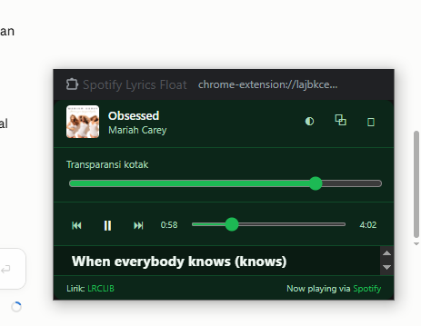

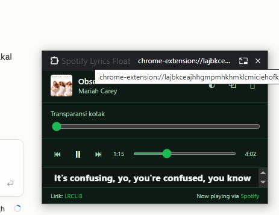

lah ini mah cuma warna hijaunya aja berkurag wkwkw

---

### 🤖 Claude — 2026-08-22T18:29:35.223Z

Iya bener, itu ekspektasi vs realita yang tadi saya bilang di awal — dan sekarang kelihatan jelas kenapa. Web page (termasuk window PiP ini) nggak punya akses ke "belakang" jendelanya sendiri. Yang terjadi pas kamu geser slider ke rendah itu bukan bikin tembus ke desktop, tapi cuma nge-blend warna hijau kotaknya dengan warna kanvas putih bawaan window Chrome — makanya hasilnya pudar/washed-out ke putih, bukan tembus pandang.

Ini bukan bug, ini memang **plafon kemampuan web API** — nggak ada satupun cara (extension, JavaScript, CSS) buat bikin window Chrome beneran transparan tembus ke aplikasi lain di belakangnya. Yang bisa bikin itu cuma aplikasi native (bukan berbasis Chrome extension) yang akses fitur "layered window" langsung ke OS Windows — di luar cakupan extension ini.

Dua pilihan realistis:

---

### 🤖 Claude — 2026-08-22T18:30:42.232Z

Now clean up `host.js`:

---

### 🤖 Claude — 2026-08-22T18:31:01.290Z

Sekarang bersihkan `styles.css` — hapus `.settings-popover` dan variabel alfa yang sudah tidak dipakai, balikin kotak jadi solid.

---

### 🤖 Claude — 2026-08-22T18:31:15.898Z

Sekarang hapus blok `.settings-popover` yang sudah tidak dipakai lagi.

---

### 🤖 Claude — 2026-08-22T18:31:21.541Z

Terakhir, cek sintaks semua file supaya bersih dari sisa referensi yang terhapus.

---

### 🤖 Claude — 2026-08-22T18:31:27.965Z

Bersih — sisanya cuma teks label yang memang tidak relevan (label "Spotify app settings" dan opacity tombol disabled, keduanya bukan sisa fitur transparansi). Fitur transparansi sudah dihapus total, kotak balik ke warna hijau solid.

**Tinggal reload:** klik ↻ di `chrome://extensions`, reload tab kontrol, lalu buka lagi kotak mengambangnya — sekarang cuma ada ikon ⧉ (float) dan ⏻ (disconnect) di pojok kanan atas, warnanya solid, dan tombol play/pause/next/prev/seek bar tetap jalan seperti sebelumnya.

---

### 👤 User — 2026-08-22T18:32:24.144Z

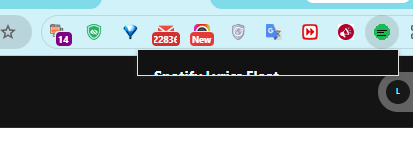

fixing ini dong biar bisa webnya dari sini

---

### 🤖 Claude — 2026-08-22T18:32:48.657Z

Ketemu penyebabnya — waktu saya perbaiki bug scroll di kotak mengambang kemarin, saya nambahin aturan `height: 100%; overflow: hidden` di `styles.css` yang ternyata ikut kepakai di popup extension juga, dan bikin popup-nya collapse cuma nyisain judulnya doang (persis kayak di screenshot kamu). Saya scope ulang biar nggak ganggu popup.

---

### 🤖 Claude — 2026-08-22T18:32:56.620Z

Sudah diperbaiki. Reload extension-nya di `chrome://extensions` (klik ↻), lalu klik lagi ikon hijau extension di toolbar — popup-nya sekarang harusnya tampil penuh dengan deskripsi + tombol "Buka Lyrics Float" yang bisa diklik.

---

### 👤 User — 2026-08-22T18:36:29.211Z

oke aman semua, ini bisa dibuat untuk iphone ga sihhh tp dari apps spotifynya

---

### 🤖 Claude — 2026-08-22T18:37:09.879Z

Jujur, ini beda liga dibanding extension Chrome tadi. Beberapa fakta penting:

- **Extension Chrome nggak bisa dipasang di iPhone sama sekali** — bahkan Chrome for iOS itu cuma "kulit" di atas Safari/WebKit, nggak support extension apa pun (apalagi Document Picture-in-Picture yang kita pakai).
- **iOS nggak punya konsep "floating box di atas aplikasi apapun"** untuk web/HTML biasa. Satu-satunya cara resmi Apple bikin sesuatu tetap terlihat lintas-app adalah:
  - **Video Picture-in-Picture** (AVKit) — trik yang dipakai app-app lirik: teks lirik di-render jadi "video" lalu dimasukkan ke PiP video asli iOS. Bisa mengambang di atas app lain, tapi butuh app native.
  - **Live Activity / Dynamic Island** (iOS 16+) — nempel di area notch/status bar & lock screen, cocok buat nampilin baris lirik yang jalan, tapi terbatas di area itu, bukan box bebas di mana saja.
- Kedua-duanya **cuma bisa dibangun sebagai aplikasi iOS native (Swift + Xcode)**, bukan extension/web. Dan Xcode **cuma jalan di macOS** — sementara kerjaan kita sekarang di Windows, jadi saya nggak bisa build maupun test-nya dari sini sama sekali.
- Kabar baiknya: bagian "otak"-nya (deteksi lagu via Spotify Web API + ambil lirik dari LRCLIB) tetap bisa dipakai ulang konsepnya — cuma "wadah"-nya harus ditulis ulang total pakai Swift.

Jadi sebelum saya lanjut ke arah manapun, saya perlu tahu dulu:

---

### 🤖 Claude — 2026-08-22T18:37:52.519Z

Kalau begitu, app iOS native itu jalan buntu total — nggak ada cara bikin/pasang app iOS tanpa Mac (nggak ada layanan yang bener-bener gratis-dan-gampang buat itu; opsi cloud-Mac semacam Codemagic/GitHub Actions macOS runner tetap butuh Apple Developer Program $99/tahun plus setup yang lumayan ribet, dan hasilnya belum tentu sepadan buat sekadar fitur lirik).

Realistisnya, dua opsi yang masuk akal buat iPhone:

1. **Pakai fitur bawaan Spotify** — di Now Playing screen app Spotify iOS, tap tombol **lirik** (ikon microphone/lirik di pojok kanan bawah player) → lirik tersinkron muncul full-screen, auto-scroll sama persis kayak yang kita bangun tadi. Gratis, udah ada, nggak perlu app tambahan.
2. Kalau maunya "kelihatan tanpa buka Spotify sama sekali" — itu di luar kemampuan platform kecuali lewat app native (yang kita udah sepakati nggak feasible tanpa Mac).

Jadi untuk iPhone, saran saya ya pakai opsi 1 aja. Extension Chrome yang udah kita bikin tetap khusus buat desktop/laptop ya.

---

### 👤 User — 2026-08-22T18:37:54.414Z

iphone aku jg iphone 13

---

### 🤖 Claude — 2026-08-22T18:38:07.597Z

Noted, tapi itu nggak mengubah kesimpulannya — masalahnya bukan tipe iPhone-nya, tapi nggak adanya akses Mac buat build app-nya. iPhone 13 sendiri malah nggak punya Dynamic Island juga (itu cuma ada di iPhone 14 Pro ke atas), jadi opsi "nempel di notch" pun sebenarnya nggak berlaku buat device kamu.

Jadi tetap saran saya: pakai fitur lirik bawaan Spotify aja di iPhone-nya. Caranya:
1. Buka app Spotify, putar lagu apa saja.
2. Di layar **Now Playing** (yang nampilin cover album gede), lihat pojok kiri bawah — ada ikon **lirik** (kotak dengan garis-garis teks).
3. Tap ikon itu → lirik tersinkron muncul, auto-scroll & highlight baris yang lagi dinyanyikan, mirip persis sama fitur yang kita bangun di extension Chrome tadi.

Kalau nggak nemu ikonnya, kemungkinan Spotify-nya perlu di-update ke versi terbaru dulu lewat App Store.

---

### 👤 User — 2026-08-22T19:37:15.382Z

tambahin button ke website spotify yg lg play lagunya dong di extensionya

---

### 🤖 Claude — 2026-08-22T19:37:16.259Z

You've hit your session limit · resets 5:20am (Asia/Jakarta)

---

### 👤 User — 2026-08-22T22:20:15.249Z

Continue from where you left off.

---

### 🤖 Claude — 2026-08-22T22:20:15.250Z

No response requested.

---

### 👤 User — 2026-08-22T22:20:17.773Z

Try again

---

### 🤖 Claude — 2026-08-22T22:20:30.727Z

Oke, saya tambahin tombol buat buka halaman Spotify dari lagu yang lagi diputar.

---

### 🤖 Claude — 2026-08-22T22:20:43.344Z

Sekarang tambahkan style disabled, lalu wiring di `host.js`.

---

### 🤖 Claude — 2026-08-22T22:20:48.221Z

Sekarang update `host.js` — tambah elemen, state URL lagu, dan handler klik.

---

### 🤖 Claude — 2026-08-22T22:21:11.287Z

Sekarang tambahkan event listener untuk membuka tab baru:

---

### 🤖 Claude — 2026-08-22T22:21:24.276Z

Sudah ditambahkan. Reload extension-nya di `chrome://extensions` (↻), lalu reload tab kontrolnya — sekarang ada ikon **↗** baru di topbar (sebelah kiri ikon ⧉) yang langsung buka tab baru ke halaman `open.spotify.com` dari lagu yang lagi diputar. Tombolnya otomatis nonaktif (redup) kalau lagi nggak ada lagu yang diputar.

---

### 👤 User — 2026-08-22T22:35:12.199Z

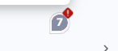

tambahin dong fitur bisa minimize yg kecil bgt sisa icon doang kayak gini

---

### 🤖 Claude — 2026-08-22T22:36:14.135Z

Oke, saya tambahin tombol "minimize" yang mengecilkan window mengambangnya jadi bubble bulat kecil (cuma foto album), klik lagi buat balikin ukuran normal — mirip chat-head gitu.

---

### 🤖 Claude — 2026-08-22T22:36:26.066Z

Sekarang tambahkan CSS untuk mode minimized.

---

### 🤖 Claude — 2026-08-22T22:36:44.339Z

Sekarang buat helper `setCoverSrc` dan pakai di dua tempat yang set `els.cover.src`:

---

### 🤖 Claude — 2026-08-22T22:36:57.728Z

Sekarang tambahkan fungsi `toggleMinimize` dan hubungkan ke `toggleFloat`:

---

### 🤖 Claude — 2026-08-22T22:37:04.807Z

Sekarang lihat isi `toggleFloat` untuk hubungkan tampil/sembunyinya tombol minimize saat masuk/keluar mode PiP:

---

### 🤖 Claude — 2026-08-22T22:37:20.068Z

Sekarang tambahkan event listener untuk `minimizeBtn` dan `miniBubble`:

---

### 🤖 Claude — 2026-08-22T22:37:42.738Z

Sudah ditambahkan. Reload extension di `chrome://extensions` (↻) dan reload tab kontrolnya, lalu:

1. Buka kotak mengambang (⧉) seperti biasa.
2. Sekarang ada tombol **–** baru di topbar (baru muncul setelah mengambang) — klik itu buat minimize jadi bubble bulat kecil (cuma foto album).
3. Klik lagi bubble-nya buat balikin ke ukuran & tampilan penuh.

Satu catatan jujur: saya pakai `window.resizeTo()` buat benar-benar mengecilkan ukuran window PiP-nya (bukan cuma nyembunyiin konten doang). Ini API standar, tapi saya belum bisa memverifikasi otomatis apakah Chrome mengizinkannya khusus untuk window Picture-in-Picture (karena automation browser saya diblokir masuk ke `chrome://extensions`). Kalau pas kamu coba window-nya nggak ikut mengecil (cuma isinya yang berubah jadi bubble di dalam kotak berukuran sama), kasih tau saya screenshot-nya — saya sesuaikan pendekatannya.

---

### 👤 User — 2026-08-23T11:53:09.604Z

simpen codenya di github aku

---

### 🤖 Claude — 2026-08-23T11:53:27.698Z

GitHub CLI-nya sudah login sebagai akun `fukusya`. Folder ini belum jadi git repo, jadi saya perlu beberapa info dulu.

---

### 🤖 Claude — 2026-08-23T11:53:43.393Z

Kayaknya pertanyaannya nggak ke-render. Boleh dijawab di chat aja: nama repo-nya mau apa (default: `spotify-lyrics-float`), dan **private** atau **public**?

---

### 👤 User — 2026-08-23T11:54:44.902Z

iyaa itu, private

---

### 🤖 Claude — 2026-08-23T11:54:54.853Z

Semua file aman (nggak ada Client ID/token yang tersimpan di kode — itu disimpan lewat `chrome.storage.local`, bukan di file). Saya init repo dan push.

---

### 🤖 Claude — 2026-08-23T11:55:12.957Z

Berhasil di-push ke [github.com/fukusya/spotify-lyrics-float](https://github.com/fukusya/spotify-lyrics-float) (private repo). Semua kode sudah tersimpan di sana, tinggal `git pull` kalau mau lanjut ngoding dari device lain.

---

### 👤 User — 2026-09-05T22:11:06.824Z

oke akan melakukan pindah device yg artinya semua conversation ini akan hilang, gmn caranya biar aku buka claude code di device baru ini semua tetep ada? atau kamu backeupin di github deh biar di claude code device baru aku tetep ada? atau dimana? km punya ide lain? maunya semuamuanya termasuk riwayat chat, file di chatnya include yg km hasilin dalam bentuk artefact atau pun file22 sertaaa yg aku kirim dalam bentuk screenshot atau file kayak excel itu ikut kesimpen juga, semua dalam 1 alamat folder/file, boleh di local boleh di github, jd outpurnya kasih aja 1 alamat file/folder tsb ya

---

### 🤖 Claude — 2026-09-05T22:14:09.264Z

Nemu tempat penyimpanan riwayat chat-nya secara lokal (termasuk semua screenshot yang kamu kirim, ternyata tersimpan utuh di situ). Saya susun jadi backup lengkap dan gabungkan ke repo GitHub yang sama biar cuma 1 alamat.

---

### 🤖 Claude — 2026-09-05T22:15:03.612Z

Ketemu bug kecil — pesan pertamamu kelewat karena formatnya beda (string polos, bukan array block). Saya perbaiki script-nya dan generate ulang.